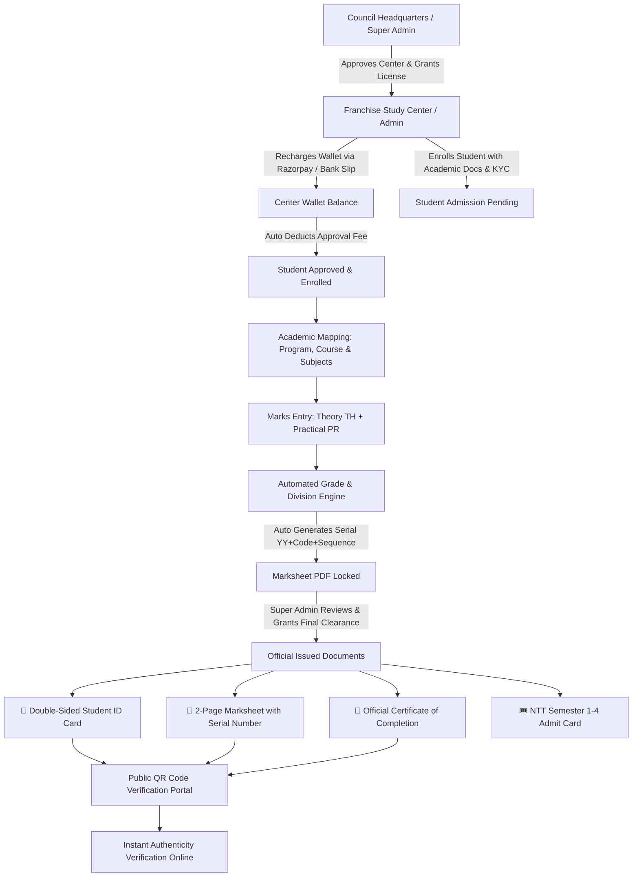

<div align="center">

# 🎓 RISE SaaS — Reliable Inclusive Skill Education
### Enterprise Multi-Tenant Vocational Education & Institute Management Platform

<p align="center">
  <a href="https://reliableinclusiveskilledu.in/">
    
  </a>
</p>

<p align="center">
  <b>An Autonomous Institution Registered Under the Companies Act, 2013 | Incorporated Under Ministry of Corporate Affairs, Govt. of India</b><br>
  <i>Empowering Vocational Training Centers, Skill Development Institutes, and Students Across India</i>
</p>

<p align="center">
  <a href="https://reliableinclusiveskilledu.in/" target="_blank">
    
  </a>
  <a href="https://github.com/najeebahmad07/reliable-inclusive-skill-edu" target="_blank">
    
  </a>
</p>

<p align="center">
  
  
  
  
  
  
  
  
  
</p>

---

[Explore Features](#-core-features--modules) •
[How It Works](#-how-the-application-works) •
[UI & Dashboard](#-modern-dashboard--ui-design) •
[Document Generation](#-tcpdf-official-document-generation-engine) •
[Installation Guide](#-step-by-step-installation-guide) •
[Developer Section](#-developer--maintainer-section)

---

</div>

## 📖 Executive Summary

**RISE (Reliable Inclusive Skill Education)** is a modern, full-stack multi-tenant SaaS application created for vocational skill councils and educational boards. It facilitates automated franchise center management, dynamic academic catalogs, student lifecycle tracking from registration to convocation, automated fee billing through wallet deductions, millimeter-accurate security document generation, and public anti-fraud QR verification.

### 🌟 Why RISE SaaS?
Traditional vocational training boards struggle with:
- Fragmented records across decentralized franchise training centers.
- Manual calculation errors in multi-subject marksheets (Theory vs. Practical exams).
- Fraudulent certificate tampering and unauthorized marksheet duplication.
- Tedious paper-based admit card generation for NTT and specialized vocational exams.
- Chaotic fee reconciliation between regional study centers and headquarters.

**RISE SaaS solves all of these challenges** through an integrated, digital-first cloud platform engineered with high contrast modern UI, bulletproof role authorization, dynamic serial numbering, and cryptographic QR verification.

---

## 🔄 How the Application Works



---

## 🎯 Core Features & Modules

### 1. 📊 Modern SaaS Dashboard & Analytics
- **4 Vibrant KPI Cards (Contrast AA Compliant)**:
  - 🔵 **Blue (`#4361EE`)**: Total Enrolled Students (with Approved vs. Pending counters).
  - 🟢 **Green (`#059669`)**: Registered Franchise Centers & Academic Programs.
  - 🔴 **Pink (`#E64980`)**: Issued Student Certificates & Processed Marksheets.
  - 🟣 **Violet (`#7C3AED`)**: Center Wallet Balances & Total Inflow Revenue.
- **Interactive ApexCharts Visualizations**:
  - **Admissions Progression (Area Line Chart)**: Real-time 6-month enrollment trend.
  - **Top Courses Distribution (Horizontal Bar Chart)**: Enrollment density across safety, teacher training, technical, and design programs.
  - **Approval Ratio (Donut Chart)**: Approved vs. Pending admission split.
  - **Activity Intensity Matrix (2D Heatmap)**: Enrollment frequency mapped across days of the week.

### 2. 🏛️ Dual-Role Multi-Tenant Architecture
- **Council Headquarters (Super Admin)**:
  - Global oversight over all registered franchise study centers.
  - Toggle center status (`Active` / `Inactive`), adjust wallet credit/debit manually with audit trails.
  - Review and approve pending student certificates and marksheets.
  - Inter-center student transfer system with automated data migration.
  - Academic Catalog builder: Manage Programs, Courses, and individual Subjects with customizable maximum and minimum pass criteria for Theory (`TH`) and Practical (`PR`).
- **Franchise Study Center (Center Admin)**:
  - Center-specific analytics dashboard.
  - Student admission wizard with personal details, qualification records (10th, 12th, UG, PG), Aadhaar upload, photo, and digital signature upload.
  - Marks entry console with instant student selector.
  - Instant wallet recharge powered by Razorpay.

### 3. 📄 Millimeter-Accurate Document Generation Engine (TCPDF)
Unlike standard HTML-to-PDF converters that produce misaligned prints, RISE incorporates a native **TCPDF vector engine** that calculates page dimensions, coordinate offsets, and borders in exact millimeters (`mm`):
- **🪪 Student ID Card (90mm × 68mm Landscape)**:
  - **Front**: Cyan/Navy/Green vector shapes, student photo, roll number, course, session, center name, and live 2D QR barcode.
  - **Back**: Student address, center address, student's uploaded signature, and authorized official signature.
- **📜 Student Certificate (A4 Landscape, 297mm × 210mm)**:
  - Cream parchment background (`#FAF7F0`), double gold (`#B8962E`) and navy (`#0D3664`) borders.
  - Prominent RISE logo, Ministry of Skill Development and MSME accreditation credentials.
  - Student name rendered in Times Bold 32pt with gold-accented program pill and division pill.
  - Dual Controller and Director signatures, official council seal, and verification QR code.
- **🏆 Center Authorization Certificate (A4 Landscape, 297mm × 210mm)**:
  - Formal council accreditation certificate for affiliated training centers with unique Cert No, Issue Date, authorized program, and seal.
- **📝 Statement of Marks / Marksheet (A4 Portrait, 2-Page Document)**:
  - **Page 1**: Diagonal watermark, unique serial number (`YY + student_code + 4-digit sequence`), complete TH/PR scheme & obtained marks table with auto-compact mode for courses with >10 subjects, division, result, and director signature.
  - **Page 2**: Comprehensive examination instructions, division thresholds (Distinction ≥80%, First Division ≥65%, Second Division ≥55%), grading chart, and verified result record seal.
- **🎟️ NTT Candidate Admit Card / Hall Ticket (A4 Portrait)**:
  - Dedicated hall ticket for Nursery Teachers Training candidates with semester selection (Sem 1 to Sem 4).
  - Automatically calculates and distributes program subjects across the 4 semesters.
  - Includes candidate photo, exam center details, and 10 candidate examination guidelines.

### 4. 💳 Wallet & Razorpay Payment Gateway
- Live Razorpay integration for fast digital wallet recharges.
- Support for offline bank transfers (NEFT/RTGS/IMPS/UPI) with payment receipt upload.
- Super Admin review dashboard to approve or reject offline recharge requests.
- Automatic deduction of program approval fee upon student admission approval.

### 5. 🔍 Public Anti-Fraud Online Verification Portal
Anyone can instantly verify the authenticity of credentials issued by RISE:
- **Student Verification (`/verify-student`)**: Real-time lookup by Roll Number or Enrollment Number.
- **Certificate Verification (`/verify-certificate`)**: Authenticates certificate validity, issue date, and student enrollment via camera or barcode reader scan.

### 6. 🎨 High-Contrast Modern UI/UX
- **No Faint Gray Text**: Strictly eliminates unreadable `#9CA3AF` / `text-gray-400` text in favor of `#172033` (primary) and `#374151` (secondary) in light mode, and `#F9FAFB` (primary) and `#D1D5DB` (secondary) in dark mode.
- **Theme Persistence**: Light and Dark mode toggle with zero-flicker `<head>` script and `localStorage` memory.
- **Responsive Navigation**: Desktop sidebar collapses to clean icon view with floating tooltips; full slide-out off-canvas drawer on mobile devices.

---

## 💻 Technology & Language Stack

| Layer | Technology | Version | Purpose |
| :--- | :--- | :--- | :--- |
| **Backend** | [PHP](https://php.net) | 8.2+ | Strongly typed, modern server-side execution |
| **Framework** | [Laravel](https://laravel.com) | 10.x | MVC architecture, routing, middleware, Eloquent ORM |
| **Database** | [MySQL](https://mysql.com) | 8.0 / MariaDB | Relational storage with foreign key constraints |
| **Frontend Styling** | [Tailwind CSS](https://tailwindcss.com) | 3.x | Utility-first responsive design with dark mode |
| **Reactivity** | [Alpine.js](https://alpinejs.dev) | 3.x | Lightweight client-side dropdowns and toggles |
| **Data Visuals** | [ApexCharts](https://apexcharts.com) | 3.45+ | Interactive area, bar, donut, and heatmap analytics |
| **Document Engine** | [TCPDF](https://tcpdf.org) | 6.6+ | Vector-grade PDF generation with 2D barcode generation |
| **Payment Gateway** | [Razorpay SDK](https://razorpay.com) | Live API | Merchant checkout and webhook/signature validation |
| **Icons & Typography**| FontAwesome 6 & Inter | 6.5 / Google | Modern iconography and high-contrast typography |

---

## 🖥️ UI & Dashboard Showcase

```text
+--------------------------------------------------------------------------------------------------+
|  🎓 RISE | Reliable Inclusive Skill Education                               ☀️/🌙 Mode | 👤 Admin |
+--------------------------------------------------------------------------------------------------+
|  [Sidebar]          |  📊 Super Admin Central Analytics Console                                  |
|  - Dashboard        |                                                                            |
|  - Students         |  +----------------+  +----------------+  +----------------+  +---------------+ |
|  - Centers          |  | 🔵 STUDENTS    |  | 🟢 CENTERS     |  | 🔴 CERTIFICATES|  | 🟣 REVENUE    | |
|  - Academics        |  |  41 Enrolled   |  |  12 Active     |  |  29 Certified  |  |  ₹ 48,500     | |
|  - Marksheets       |  +----------------+  +----------------+  +----------------+  +---------------+ |
|  - Certificates     |                                                                            |
|  - Wallet           |  +-------------------------------------+  +------------------------------+ |
|  - Verification     |  | 📈 Monthly Admissions Trend (Line)  |  | 🍩 Approval Ratio (Donut)   | |
|  - Settings         |  |    May -> Jun -> Jul -> Aug -> Sep  |  |    85% Approved | 15% Pending| |
|                     |  +-------------------------------------+  +------------------------------+ |
|                     |  +-------------------------------------+  +------------------------------+ |
|                     |  | 📊 Top Courses by Enrollment (Bar)  |  | 🗓️ Weekly Activity (Heatmap) | |
|                     |  |    Advance Safety, NTT, Mehendi...  |  |    Mon Tue Wed Thu Fri Sat   | |
|                     |  +-------------------------------------+  +------------------------------+ |
+---------------------+----------------------------------------------------------------------------+
```

---

## 📂 Project Directory Structure

```text
rise2_laravel/
├── app/
│   ├── Http/
│   │   ├── Controllers/
│   │   │   ├── AcademicController.php            # Programs, courses, and subject schemes
│   │   │   ├── AdminManagementController.php     # Center franchisees & wallet adjustments
│   │   │   ├── AuthController.php                # Authentication, sessions & authorization
│   │   │   ├── CertificateController.php         # ID card, certificate & admit card endpoints
│   │   │   ├── DashboardController.php           # Real-time analytics & chart data feeds
│   │   │   ├── JobController.php                 # Career listings & candidate applications
│   │   │   ├── MarksController.php               # Examination evaluation & marksheet builder
│   │   │   ├── NoticeNotificationController.php  # Public notices & center broadcast alerts
│   │   │   ├── PlacementStudentController.php    # Student placement & success showcase
│   │   │   ├── ProfileController.php             # Profile editor & password change
│   │   │   ├── StudentController.php             # Student admission pipeline & center transfer
│   │   │   ├── VerificationController.php        # Public QR code student & cert validator
│   │   │   └── WalletController.php              # Razorpay checkout, recharge & audit logs
│   │   └── Middleware/                           # SuperAdmin & role gatekeepers
│   ├── Models/                                   # Eloquent models & schema relationships
│   └── Services/
│       └── DocumentPdfService.php                # Millimeter-precision TCPDF generation engine
├── config/                                       # Application & service configurations
├── database/
│   ├── migrations/                               # Complete database schema migrations
│   └── seeders/                                  # Default super admin & academic seeders
├── lib/
│   └── TCPDF/                                    # Embedded TCPDF PDF rendering engine
├── public/
│   ├── assets/
│   │   ├── images/                               # Official logo, seals, authorized signatures
│   │   └── js/                                   # Dark mode toggle & frontend helpers
│   └── uploads/                                  # Uploaded student photos, signatures, PDFs
├── resources/
│   ├── css/                                      # Tailwind CSS sources
│   ├── js/                                       # JavaScript entry points
│   └── views/                                    # High-contrast Blade templates
│       ├── academic/                             # Program, course & subject views
│       ├── admin_management/                     # Center franchisees management views
│       ├── auth/                                 # Modern authentication views
│       ├── certificates/                         # Official document views
│       ├── dashboard/                            # Super Admin & Center Admin dashboards
│       ├── layouts/                              # Master app layout & theme switcher
│       ├── marks/                                # Marksheet entry & lookup views
│       ├── students/                             # Student admission & show views
│       └── verification/                         # Public search views
├── routes/
│   └── web.php                                   # Named application routes (81 routes)
└── .env                                          # Environment variables configuration
```

---

## 🚀 Step-by-Step Installation Guide

Follow these instructions to set up and run the application on your local machine or VPS server.

### Prerequisites
- **PHP**: `^8.1` or `^8.2` (with `pdo_mysql`, `mbstring`, `openssl`, `curl`, `gd`, `zip` extensions enabled)
- **MySQL**: `^5.7` or `^8.0` / MariaDB
- **Composer**: `^2.x`
- **Git**

---

### Step 1: Clone the Repository
```bash
git clone https://github.com/najeebahmad07/reliable-inclusive-skill-edu.git
cd reliable-inclusive-skill-edu
```

---

### Step 2: Install PHP Dependencies
```bash
composer install --no-dev --optimize-autoloader
```

---

### Step 3: Configure Environment Variables
Copy `.env.example` to `.env` (or use the included `.env`):
```bash
cp .env.example .env
```
Open `.env` and verify your database configuration:
```dotenv
APP_NAME="RISE"
APP_TAGLINE="Reliable Inclusive Skill Education"
APP_ENV=local
APP_KEY=base64:XhQzCvEXyxozi1DPPA78rfY2kxm3wW8Wkhusm4oVnD4=
APP_DEBUG=true
APP_URL=http://localhost:8000

DB_CONNECTION=mysql
DB_HOST=127.0.0.1
DB_PORT=3306
DB_DATABASE=rise_saas_new
DB_USERNAME=root
DB_PASSWORD=your_password_here

# Razorpay Payment Gateway
RAZORPAY_KEY_ID=your_razorpay_key_id
RAZORPAY_KEY_SECRET=your_razorpay_key_secret

# Wallet Rules
MIN_RECHARGE_AMOUNT=100
DEFAULT_APPROVAL_FEE=2000
CURRENCY=INR
CURRENCY_SYMBOL="₹"
```

---

### Step 4: Generate Application Key
```bash
php artisan key:generate
```

---

### Step 5: Run Database Migrations
```bash
php artisan migrate
```

---

### Step 6: Create Storage Symlink & Clear Caches
```bash
php artisan storage:link
php artisan optimize:clear
```

---

### Step 7: Launch the Development Server
```bash
php artisan serve
```
Open your browser and navigate to:
```text
http://127.0.0.1:8000
```

---

## 🔑 Default User Roles & Permissions

| Role | Access Scope | Capabilities |
| :--- | :--- | :--- |
| **Super Admin** | Council Headquarters | Full management of centers, wallet balances, student transfers, academic subjects, final marksheet/certificate approvals, and financial logs. |
| **Admin** | Franchise Training Center | Admissions enrollment, marks entry, student ID cards, marksheet printing, NTT admit card downloads, and Razorpay wallet recharges. |

---

## 👨‍💻 Developer & Maintainer Section

### 🌟 Project Author
- **Developer**: **Najeeb Ahmad**
- **GitHub**: [@najeebahmad07](https://github.com/najeebahmad07)
- **Organization**: [Reliable Inclusive Skill Education (RISE)](https://reliableinclusiveskilledu.in/)
- **Contact / Support**: `info@reliableinclusiveskilledu.in`

### 🛠️ Contribution Guidelines
We welcome contributions to improve RISE SaaS!
1. **Fork** the repository on GitHub.
2. Create a feature branch:
   ```bash
   git checkout -b feature/AmazingFeature
   ```
3. Commit your enhancements:
   ```bash
   git commit -m "Add AmazingFeature"
   ```
4. Push to your branch:
   ```bash
   git push origin feature/AmazingFeature
   ```
5. Open a **Pull Request** explaining the context of your change.

### 🛡️ Security Vulnerabilities
If you discover any security-related issues, please contact the development team via email at `info@reliableinclusiveskilledu.in` rather than opening a public issue.

---

## 📜 License

This project is open-source software licensed under the **[MIT License](LICENSE)**.

---

<div align="center">

**Reliable Inclusive Skill Education (RISE)**  
*Autonomous Institution Regd. under the Companies Act, 2013 | Ministry of Corporate Affairs, Govt. of India*  
🌐 **Website:** [reliableinclusiveskilledu.in](https://reliableinclusiveskilledu.in/)

</div>